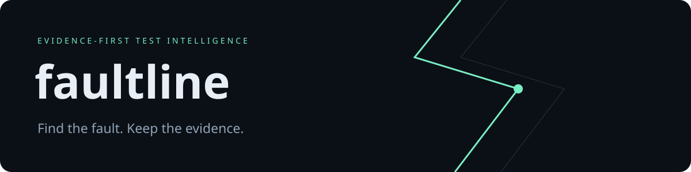
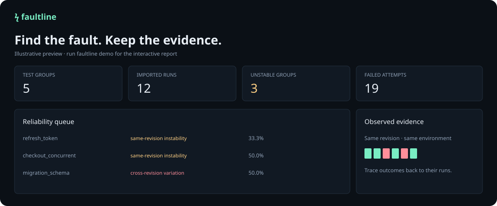

<p align="center"></p>

<p align="center">
  <a href="https://github.com/adinax031-boop/faultline/actions/workflows/ci.yml"></a>
  
  
  <a href="LICENSE"></a>
</p>

**Test reliability you can explain.** Faultline turns JUnit reports into a local evidence explorer: revision-aware instability detection, failure fingerprints, confidence intervals, and a portable interactive dashboard.

A failed test that passes after a code change may have been fixed. A failed test that passes on the *same revision and environment* deserves a closer look. Faultline keeps those cases separate.

## Try it in 30 seconds

```sh
git clone https://github.com/adinax031-boop/faultline.git
cd faultline
python -m pip install .
faultline demo --output demo.html
# Open demo.html in your browser.
```

Python 3.10+; no runtime dependencies, servers, tokens, accounts, telemetry, or external dashboard assets. The package is installed from source; it is not currently published on PyPI.



## What ships

- **Revision-aware findings:** same-revision instability, cross-revision variation, consistent failure, clean observations, and skipped-only histories.
- **Explicit provenance:** run, revision, environment and shard identifiers accompany every attempt. Atomic SQLite imports reject conflicting duplicates.
- **Retry support:** repeated testcases plus Maven `flakyFailure`, `flakyError`, `rerunFailure` and `rerunError` extensions.
- **Evidence dashboard:** searchable/filterable queue, outcome tiles, complete observation inspector, failure fingerprints, JSON download.
- **Transparent statistics:** 95% Wilson intervals and an information-per-cost rerun ranking. No opaque flakiness score.
- **Automation:** HTML, JSON, Markdown, and an opt-in instability gate with documented exit codes.
- **Bounded input:** reject DTD/entities, non-finite durations, oversized XML and excessive observations; safe HTML/JSON rendering.

## Analyze your reports

Collect JUnit output from your test runner. Import reports from repeated CI executions, preserving their actual revision and environment:

```sh
faultline ingest examples/fail.xml --db history.db \
  --run build-101 --revision 1a2b3c --environment linux-python312
faultline ingest examples/pass.xml --db history.db \
  --run build-102 --revision 1a2b3c --environment linux-python312
faultline report --db history.db --output reliability.html
faultline report --db history.db --format markdown --output reliability.md
faultline report --db history.db --format json --output reliability.json
```

Both examples use the same revision, so the mixed pass/fail result becomes an instability finding. `faultline demo` also contains a migration test whose outcome changes at a revision boundary: Faultline labels it cross-revision variation.

For split reports, provide `--shard unit` or `--shard integration`. All shards in a run must share revision and environment. Re-importing identical normalized observations with identical provenance is a no-op. Changing an already imported run/shard is rejected rather than silently replacing history.

Choose run IDs that identify individual CI executions/attempts, e.g. `12345-attempt-2`. Use a full commit SHA in production. An environment label should include relevant OS, runtime, dependency/lockfile version, test flags and infrastructure. The tool cannot verify those labels.

### CI policy

```sh
faultline report --db history.db --format markdown \
  --output reliability.md --fail-on-instability
```

Exit codes: **0** success; **1** observed same-revision instability when the gate is requested; **2** invalid input, storage, or output errors. The report is written before exit 1. Ordinary report generation does not fail on findings.

See [CI integration](docs/ci.md) for durable history and artifact handling. The included workflow tests Faultline; it does not magically download your project's past reports.

## Interpret findings carefully

| Finding | Evidence | Next step |
|---|---|---|
| Same-revision instability | Both pass and failure under one revision/environment | Reproduce with recorded conditions; investigate state, timing and infrastructure |
| Cross-revision variation | Mixed history but no revision has both outcomes | Review changes and rerun the affected revision |
| Consistent failure | All executed attempts failed | Investigate a persistent defect or environment problem |
| No failure observed | All executed attempts passed | Continue monitoring; absence of failures is not proof of reliability |
| Only skipped | No executed attempts | Check coverage and skip configuration |

**Limits:** this is a deliberately focused v0.1 engineering tool, not a benchmark-validated SOTA detector. Same-revision variation is evidence of instability, not proof of a test bug. Infrastructure and uncontrolled inputs can explain it. Wilson intervals assume independent observations; retries often violate that assumption. Rerun priority is a heuristic, not a probability or quarantine recommendation. Fingerprints can merge unrelated failures. No automatic root-cause diagnosis, quarantine, retention policy or network integrations.

History is ordered lexicographically by run ID, then shard/attempt; timestamps and chronology are not inferred. Suite/class/name/environment forms a test identity. Every parameterized case must have a unique name. Duplicate identities are treated as attempts, including duplicates across shards; ensure identities are meaningful. Only explicit JUnit pass/failure/error/skipped outcomes and documented retry tags are supported. Vendor extensions may require an adapter. Failure samples are truncated to 4,000 characters, and retry durations are not inferred.

## Develop

```sh
python -m pip install -e .
python -m unittest discover -s tests -v
python -m compileall -q src
python scripts/benchmark.py
```

The suite exercises parsing, retry semantics, unsafe input, provenance conflicts, transactional rollback, revision/environment isolation, statistics, output escaping, reproducibility, and CLI policy. CI runs on Linux, Windows, and macOS with a Python version matrix and builds/installs the wheel.

[Architecture & methodology](docs/architecture.md) · [Contributing](CONTRIBUTING.md) · [Security](SECURITY.md) · [MIT license](LICENSE)
